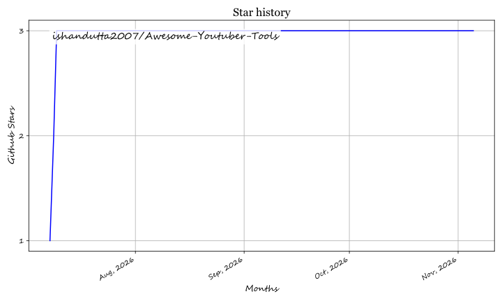

# Awesome-Youtuber-Tools

  

  
  
  

## 🎥 Top Video Editing Tools for YouTubers Ecosystem

**Curated List of SaaS Products & Open-Source GitHub Projects**  
*Focused on YouTube Content Creation, Editing & Production*  
**Last updated: March 2026**

This repository tracks notable **SaaS platforms** and **open-source projects** for **Video Editing Tools for YouTubers**. These tools help creators edit footage, add effects, generate captions, create thumbnails, optimize for algorithms, and produce high-quality content efficiently.

**Examples** include Adobe Premiere Pro, DaVinci Resolve, Final Cut Pro, CapCut, Gling.ai, and Opus Clip (the category leaders). Tools listed here emphasize **speed**, AI features, YouTube-specific optimizations, and creator-friendly workflows.

**Open-source emphasis**: This section is heavily expanded with every major active project for self-hosting, full customization, no licensing costs, and complete creative control — ideal for YouTubers, indie creators, and open-source enthusiasts.

Contributions welcome! Open a PR to add/update entries. Keep descriptions factual and link to official sites.

## 📋 Table of Contents
- [Sector Overview & Market Dynamics](#sector-overview--market-dynamics)
- [SaaS Products](#saas-products)
- [Open-Source GitHub Projects](#open-source-github-projects)
- [How to Contribute](#how-to-contribute)
- [Disclaimer](#disclaimer)
- [Support](#support)

## ☁️ SaaS Products

### 📊 Sector Overview & Market Dynamics

The global video editing software and creator economy tooling market is estimated at **$3.5B–$5.2B+ in 2026** (projected to reach over $7B by 2030 at ~6–8% CAGR). The sector exhibits **moderate fragmentation with a bifurcated dynamic**: legacy desktop NLE suites remain heavily concentrated among category giants (Adobe, Apple, and Blackmagic Design), while the rapid emergence of browser-first, text-based, and AI repurposing tools (such as CapCut, Descript, and Opus Clip) has introduced high fragmentation and niche specialization across creator workflows.

### 🎯 Core Platforms (Video Editing for YouTubers)

| Product | Description | Pricing | Free Tier Limit | Company Size (Valuation/Revenue) |
| :--- | :--- | :--- | :--- | :--- |
| **[Adobe Premiere Pro](https://www.adobe.com/products/premiere.html)** | Industry-standard video editor with powerful AI features and seamless integration with other Adobe tools. | ~$22.99/mo | No free tier (7-day free trial) | ~$87B Valuation |
| **[Camtasia](https://www.techsmith.com/camtasia.html)** | Screen recorder and video editor designed for tutorials, how-tos, and software walkthroughs on YouTube. | ~$14.99/mo ($179.88/yr) | No free tier (14-day free trial with watermark) | ~$100M+ Revenue |
| **[CapCut](https://www.capcut.com/)** | User-friendly mobile and desktop editor with strong AI features, auto-captions, and TikTok/YouTube optimization. | $19.99/mo | Basic editing tools; Pro templates/effects restricted | ~$200B+ Valuation |
| **[Clipchamp](https://clipchamp.com/)** | Cloud-based video editor featuring intuitive timeline tools, royalty-free stock assets, and AI speech synthesis. | $11.99/mo | Unlimited 1080p exports without watermark; premium filters/assets restricted | ~$3T Valuation |
| **[DaVinci Resolve](https://www.blackmagicdesign.com/products/davinciresolve)** | Professional-grade editor with excellent color grading, Fairlight audio, and Fusion VFX. | $295 one-time | Comprehensive tools up to 4K 60fps (no watermark) | ~$500M Revenue |
| **[Descript](https://www.descript.com/)** | AI-driven text-based video editor offering automatic transcription, Studio Sound, and filler-word removal. | Starts at $12/mo | 1 hour/mo transcription, 720p watermark-free export | ~$550M Valuation |
| **[Final Cut Pro](https://www.apple.com/final-cut-pro/)** | Fast and intuitive editor exclusive to macOS with Magnetic Timeline and AI tools. | $299.99 one-time (Mac) / $4.99/mo (iPad) | No free tier (90-day free trial) | ~$3T Valuation |
| **[Gling.ai](https://gling.ai/)** | AI-powered editor that automatically removes silences and creates engaging YouTube videos. | Starts at $20/mo | 1 video export / 1 hour total (with watermark) | <$10M Valuation |
| **[Kapwing](https://www.kapwing.com/)** | Collaborative browser-based video editor tailored for creators, subtitle generation, and clip resizing. | Starts at $16/mo | Exports up to 7 minutes (720p) with watermark; 3 subtitle exports/mo | ~$100M Valuation |
| **[Opus Clip](https://opus.pro/)** | AI tool that turns long videos into multiple short, viral clips optimized for YouTube and social media. | Starts at $15/mo | 60 mins/month (with watermark, expires in 3 days) | $215M Valuation |
| **[Runway](https://runwayml.com/)** | AI creative suite providing generative video tools, motion tracking, background removal, and inpainting. | Starts at $12/user/mo | 125 one-time generation credits, 720p export | ~$1.5B Valuation |
| **[VEED.IO](https://www.veed.io/)** | Cloud-based video suite featuring auto-subtitles, AI avatars, screen recording, and YouTube templates. | Starts at $18/mo | Exports up to 10 mins (720p) with watermark; 30 mins subtitles/mo | ~$35M+ ARR |
| **[Vidmoat](https://www.vidmoat.com/)** | Hosted AI video editor: describe the edit in chat, review it on a real multi-track timeline, and render MP4. Auto-captions, silence and filler-word removal, and auto-reframe for YouTube, Shorts, Reels and TikTok. | Free plan; Creator $19/mo; Studio $49/mo | Free Hobby plan with no card: 3 projects, 720p exports with a small watermark, monthly AI credit allowance | Pre-revenue startup (Buzz Innovations Ltd) |
| **[Wondershare Filmora](https://filmora.wondershare.com/)** | Accessible desktop video editor with AI smart cutout, audio denoiser, and rich effect libraries. | $49.99/yr or $79.99 perpetual | Full feature access, but all exports include a watermark | ~$2B Valuation |

### 🚀 Advanced & Specialized Platforms

**Other notable mentions**: Filmora, HitFilm, and various AI-assisted editing tools.

## 🔓 Open-Source GitHub Projects

### ✂️ Dedicated Video Editing Tools for YouTubers

- **[LosslessCut](https://github.com/mifi/lossless-cut)**   
  Extremely fast open-source tool for lossless cutting and trimming of YouTube footage.

- **[Blender Video Sequence Editor](https://github.com/blender/blender)**   
  Powerful open-source 3D suite with a capable video editor for complex YouTube projects.

- **[Shotcut](https://github.com/mltframework/shotcut)**   
  Cross-platform open-source editor with native timeline editing and hardware acceleration support.

- **[Olive Video Editor](https://github.com/olive-editor/olive)**   
  Modern open-source non-linear video editor aiming for professional features.

- **[OpenShot](https://github.com/OpenShot/openshot-qt)**   
  User-friendly open-source video editor with excellent animation and title tools for YouTubers.

- **[Kdenlive](https://github.com/KDE/kdenlive)**   
  Professional open-source video editor with timeline editing, effects, and strong YouTube export options.

- **[Flowblade](https://github.com/jliljebl/flowblade)**   
  Fast and efficient open-source multitrack video editor designed for Linux.

- **[Pitivi](https://github.com/GNOME/pitivi)**   
  GNOME-based open-source video editor with a focus on simplicity and GStreamer integration.

- **[OrkasVideoStudio](https://github.com/Orkas-AI/Orkas-VideoStudio)**  — Local-first CLI and MCP toolkit for agent-driven video composition, editing, transcription, and captions.

- **[DaVinci Resolve Free Version](https://www.blackmagicdesign.com/products/davinciresolve)**  
  Industry-leading free professional editor with full color, audio, and VFX capabilities.

- **[Cinelerra](https://github.com/cinelerra)** (and forks)  
  Long-standing open-source video editing and compositing software.

### 💡 Additional Strong Open-Source Options

- **[FFmpeg](https://github.com/FFmpeg/FFmpeg)**  scripts and GUIs for batch processing and optimization.
- **[HandBrake](https://github.com/HandBrake/HandBrake)**  — Open-source video transcoder for YouTube-ready exports.
- **[Krita](https://github.com/KDE/krita)**  with animation tools for thumbnails and motion graphics.
- **[Natron](https://github.com/NatronGitHub/Natron)**  — Open-source compositing software for VFX in YouTube videos.
- **[GIMP](https://github.com/GNOME/gimp)**  with video plugins for image-based YouTube assets.

**Recommended Toolchains**: **Kdenlive** or **Shotcut** + **Blender** for complex projects + **LosslessCut** for fast trimming + **FFmpeg** for final optimization.

## 🤝 How to Contribute

1. Fork the repo.
2. Add/edit entries in `README.md` (follow existing format).
3. Include: name, link, 1–2 sentence description, and whether it's SaaS or open-source.
4. Submit PR with a short explanation.

Star the repo if you find it useful!

## ⚠️ Disclaimer

- This is a **community-curated** list — not exhaustive and not an endorsement.
- Professional workflows may require specific features only available in commercial tools.
- Open-source tools may have a learning curve but offer unmatched customization.

---

**Made for YouTubers, content creators, vloggers, and video editors.**  
Let's make high-quality video editing more accessible, powerful, and free.

## 💖 Support

Thank you for checking out this project! If you found this curated list helpful for your YouTube production workflow, please consider supporting the project:

- ⭐ **Star** this repository on GitHub to boost visibility.
- 🍴 **Fork** and contribute your favorite creator tools and platforms.
- 📢 **Share** this list with fellow creators, video editors, and communities.
- ☕ **Buy me a coffee / Sponsor** the project via the [GitHub Sponsors Dashboard](https://github.com/sponsors/ishandutta2007) to support ongoing curation and maintenance:

  

## 🌟 Star History

<a href="https://www.star-history.com/?repos=ishandutta2007%2FAwesome-Youtuber-Tools&type=date&legend=bottom-right">
<picture>
<source media="(prefers-color-scheme: dark)" srcset="https://api.star-history.com/chart?repos=ishandutta2007/Awesome-Youtuber-Tools&type=date&theme=dark&legend=bottom-right" />
<source media="(prefers-color-scheme: light)" srcset="https://api.star-history.com/chart?repos=ishandutta2007/Awesome-Youtuber-Tools&type=date&legend=bottom-right" />

</picture>
</a>

## ⭐ Star History

<a href="https://star-history.com/#ishandutta2007/Awesome-Youtuber-Tools&Timeline" align="center">
  <picture>
    <source media="(prefers-color-scheme: dark)" srcset="assets/ishandutta2007_Awesome-Youtuber-Tools_growth.svg">
    
  </picture>
</a>
